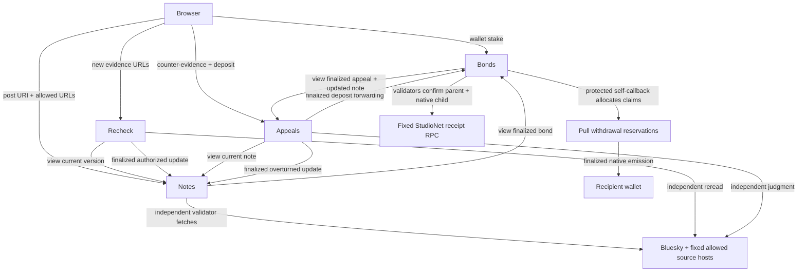

# Architecture

Footnote's authoritative boundary is the source judgment and resulting escrow settlement. The browser owns forms, wallet requests, post display and navigation. The read-only Next.js API reads finalized contract state and the public Bluesky AppView; it holds no signing key and makes no authoritative label decision.

## Notes

Notes exclusively owns note data. At creation it rejects invalid IDs, more than 20 open notes per writer, more than three notes per post per writer, malformed AT URIs and disallowed hosts before fetching or calling a model. It requires a finalized bond belonging to the writer. The fingerprint is SHA-256 of the exact decoded post text, without whitespace normalization: even a post-text edit should make the old post unavailable.

The nondeterministic leader fetches post and page content. A validator runs an independent judgment, fetches the leader's quoted sources itself, validates exact quotation membership, and compares only evidence, tone, allegation flag and a sorted deduplicated citation set. Free text and incidental page bytes do not participate in the equivalence rule.

Creation and authorized updates stage a pending decision. A protected self-callback emitted on finalization appends a history version and exposes it as active. Only the wired Recheck and Appeals addresses may call `apply_update`, and their reason must match their role. Expected-version checks reject stale or concurrent updates. The allegation flag is sticky; plain code coerces forbidden allegation labels to UNSUPPORTED.

## Recheck

Anyone supplies additional allowlisted URLs. Recheck reads Notes, reruns source-grounded classification, and tracks attempts per note version. A changed label, citation set or canonical source digest produces an auditable new version. Unchanged evidence is UNCERTAIN. After two UNCERTAIN results for the same input set, the next request is rejected before any fetch. A distinct allowed correction URL enables a new evidence probe.

There is an unavoidable boundary: detecting a same-URL content change requires fetching that URL. The pre-fetch spam rule therefore requires a new correction URL to unlock an exhausted version; it cannot both reject before fetching and discover an arbitrary same-URL edit. This limitation is explicit rather than hidden in a model call.

## Appeals

Anyone may contest the active version before the immutable bond deadline. An appeal deposits at least 2 GEN, snapshots the version, validates sources, and reserves its unique `note:version` key. A protected callback forwards the deposit to Bonds; Bonds checks the appeal binding and exact value and marks it held only after its own finality callback.

Permissionless `judge` requires the deposit to be held. Validators independently classify the counter-evidence and then answer UPHELD, OVERTURNED or UNCERTAIN. Code disallows an overturn without a changed evidence label and an uphold with a changed label. An unavailable post returns UNCERTAIN. Finalization authorizes a Notes update only for OVERTURNED.

The separate `settle_appeal` step avoids assuming asynchronous child ordering: Bonds requires the appeal's result and its matching Notes history update to be finalized before allocating an overturned bond. A pending appeal blocks ordinary bond release, even if the original time window has closed. A stale appeal following a racing recheck requires operational resolution; there is no privileged override in this version.

## Bonds

Bonds holds writer bonds and finalized forwarded deposits, never note content. Finalized settlement allocates claims: overturned bond to appellant; deposit to writer for UPHELD, otherwise back to appellant. UNCERTAIN is deliberately neutral. Overturned reputation increments once; a surviving writer bond increments upheld reputation at release after the original 72-hour window.

Withdrawal reserves one exact claim and attempt before emitting a native transfer on finality. It never calls a reservation paid. Permissionless verification fetches the immutable parent and its one native child from the fixed StudioNet RPC. Code validates method/calldata, sender, contract, claim ID, attempt, child linkage, exact recipient/value, finalized native type and explicit `value_credited` boolean. Missing or pending evidence leaves the claim reserved. Only a protected verification callback marks paid or failed. A failed claim can retry only at the next attempt and after full unpaid backing is restored; duplicate, delayed and unrelated evidence cannot unlock it.

## Deployment and operational bounds

Contracts deploy as four standalone files pinned to the requested runner. Addresses are set once in a bootstrap sequence: Notes → Bonds → Recheck → Appeals, then wire Bonds and Notes. Fixed source hosts are constructor parameters. Source inputs are capped at eight URLs, URLs at 2,048 characters, quotes at 700 characters, and read pages at 50 note IDs. There is no globally exhaustible note capacity; the practical safety ceiling is per-address quotas plus bounded request payloads. An individual version history is append-only and currently has no hard version cap.

Receipt scripts persist hashes before waiting; a timeout is resumed, never resubmitted. Every receipt distinguishes finality from execution success and follows all emitted children. The network verifier signs no transactions.
