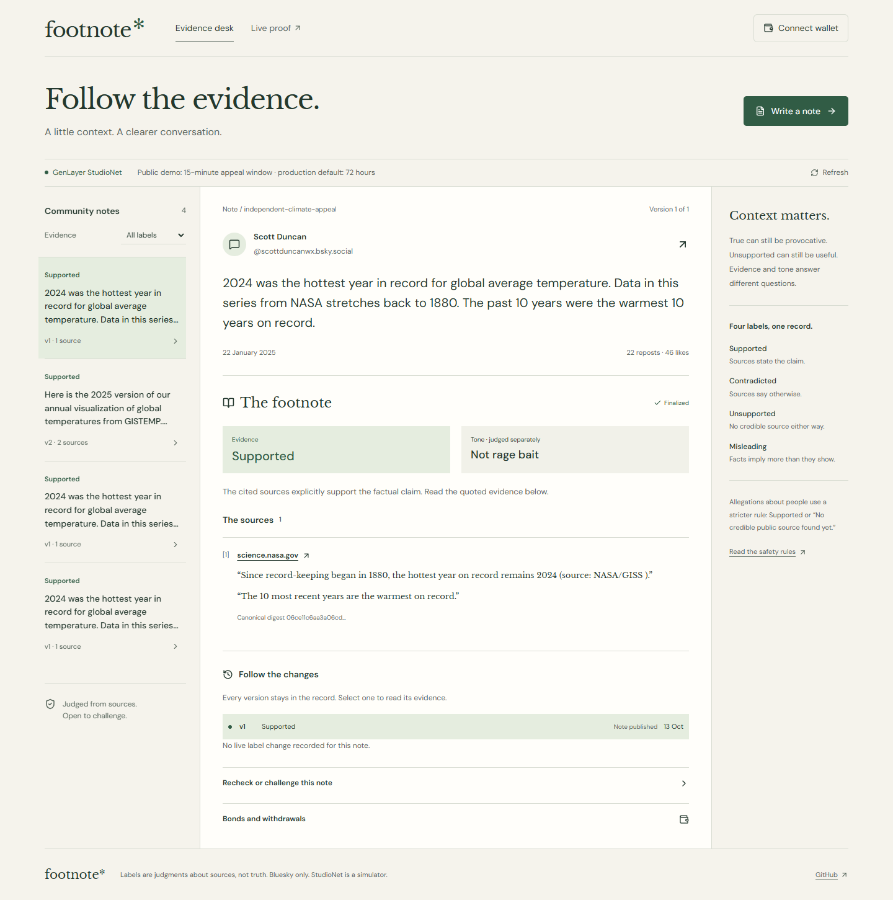
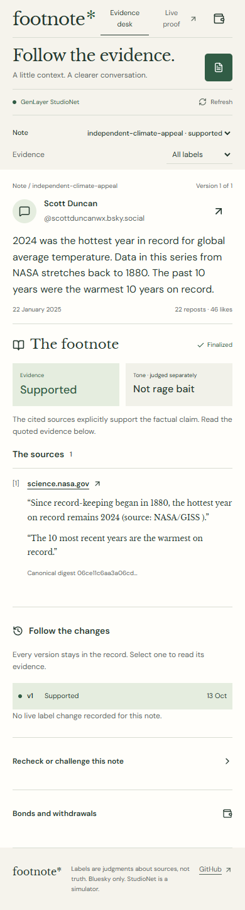
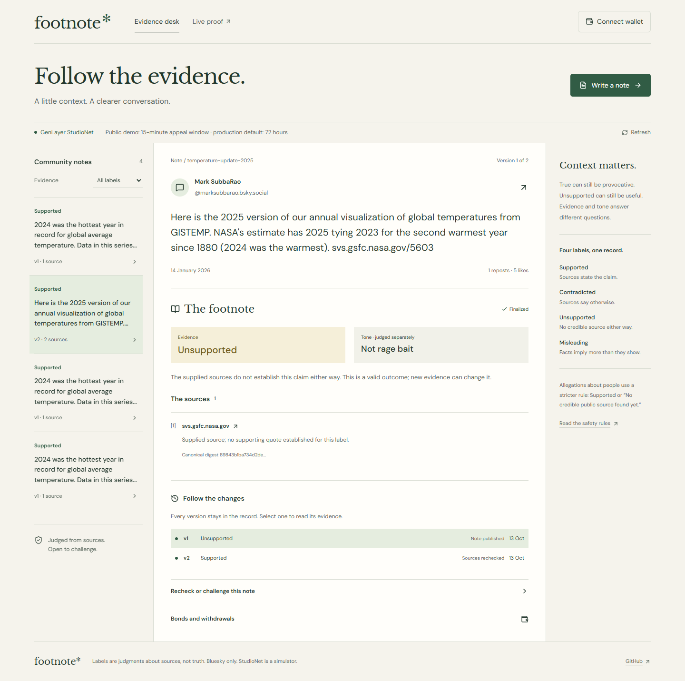
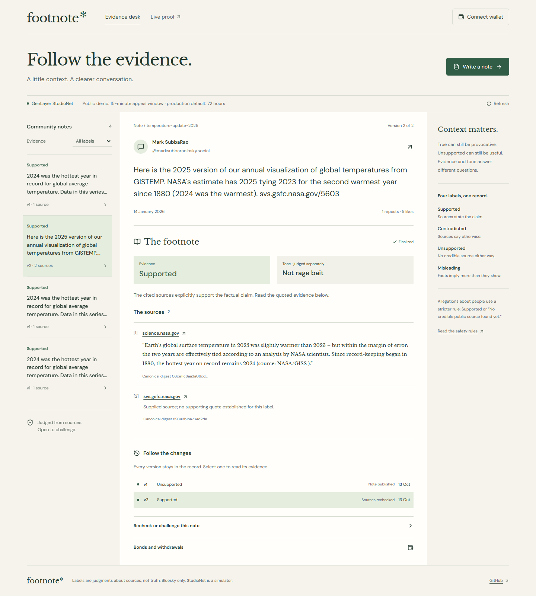

# Build a source-grounded note with Footnote

Footnote asks whether a Bluesky claim is supported by its supplied sources and whether its tone provokes. Evidence and tone remain separate: true can be provocative, and calm can be unsupported. Neither quotes nor validator majorities establish objective truth.

GenLayer StudioNet uses chain 61999 and simulated GEN. Reading needs no wallet; writes use a connected wallet with the GenLayer plugin. The server reads data and holds no signing key.

## Open the evidence desk

Start the app locally with `npm ci`, `npm run build`, and `npm run start`. It serves port 3117. The first screen is **Evidence desk**, a compact case file with the post, its judgment, the sources and the version history. On desktop the note index sits beside the case file; on mobile it becomes a compact note selector. **Live proof** opens the contract links and the manifest. **Write a note** opens the creation form.



The page reads finalized Notes state and retrieves the public post from Bluesky. It checks SHA-256 against the stored fingerprint. Deleted or edited posts show unavailable while their original note history remains.



## Prepare a real post and sources

Use an AT URI such as `at://did:plc:…/app.bsky.feed.post/…`. A normal profile URL is not the contract input. The DID form avoids persisting the author's human-readable handle. Notes checks the URI format before nondeterministic work. A note ID is a lowercase identifier, for example `climate-record`, and cannot be reused. The writer is the transaction wallet, which does not establish ownership of the Bluesky account.

Supply one to eight HTTPS source URLs from the deployment's fixed host allowlist. The form exposes **Allowed source hosts**. Code checks exact hostname membership, rejecting lookalike domains, HTTP, credentials in the URL, nonstandard ports and fragments. Adding a source does not make it credible for every claim: relevance and substantive support still need validator judgment. Prefer a short stable source page that states the claim directly.

Before the live demonstration, run `python scripts/preflight-extra.py`. It fetches each exact public post and reads each selected source three times. It decodes HTML entities, removes script/style text, strips tags, collapses whitespace and hashes canonical extracted text. JSON is parsed and serialized with sorted keys first. Every canonical digest must match across all three fetches. The script also checks that the selected exact quotation appears. If a page returns an access-denied response or its digest varies, choose a different approved source before making a live note.

The current long-source example uses NASA's global-temperature page and Scott Duncan's real post about the 2024 record. For temperature-update-2025, the original supplied NASA page covers 2021 and does not establish the post's 2025 claim; the finalized initial judgment is UNSUPPORTED. Adding the genuine NASA global-temperature page through Recheck produces SUPPORTED v2, retaining the original. This proves a change in supplied evidence, not that the claim lacked a source anywhere on the internet or that a publisher edited its page. The exact outcomes and per-write preflights are in PROOF_MANIFEST.md.

## Finalize the bond, then publish

Click **Write a note**, enter the note ID, AT URI and source URLs, and choose a writer bond from 2 to 20 simulated GEN. **Stake bond** submits the Bonds transaction. The UI stores its hash immediately. If polling times out, **Resume transaction** checks the same transaction; it does not submit another stake. Wait for the stake and its protected callback to finalize. The form then offers **Publish note** for that bonded ID.

```python
@gl.public.write.payable
def stake(self, note_id: str) -> None:
    require(2 * GEN <= int(gl.message.value) <= 20 * GEN,
            'bond 2–20 simulated GEN')
    # Reserve writer, amount and immutable configured deadline.
    gl.get_contract_at(gl.message.contract_address).emit(
        on='finalized').finalize_stake(note_id)
```

Notes reads Bonds through `gl.get_contract_at(addr).view().get_bond(note_id)`. It requires the bond to be finalized, locked, unexpired and owned by the writer. It also checks the writer's quotas: at most 20 open notes, and at most three notes on a particular post. Another writer has separate counters; there is no small shared global capacity for an attacker to exhaust. These checks happen before web fetches or model calls.

Publishing runs the source judgment and stages a pending decision. Only a self-call emitted on finalization makes the note active and appends version one. The frontend displays the evidence label, the independent tone label and the exact source quotations. A non-UNSUPPORTED judgment must contain at least one supplied URL and a quote found in its decoded source text. A missing quote is rejected in code rather than being accepted because the model sounded confident.

## Understand independent validation

The leader and validators use `gl.vm.run_nondet_unsafe` with explicit functions. A validator does its own substantive judgment and checks the leader's quotation against its own fetch. Comparison includes only evidence label, tone label, person-allegation flag and a sorted deduplicated cited URL set. Quote spans can differ across models. Every leader quote must still occur in each validator's own canonical page after whitespace, curly-quote and en/em-dash normalization; case and words stay exact. Free-form explanations never determine equivalence. Canonical source digests record the observation, while incidental HTML bytes do not determine agreement.

```python
def compared(decision):
    return (
        decision['evidence_label'],
        decision['tone_label'],
        decision['IS_ALLEGATION_ABOUT_PERSON'],
        sorted(set(c['url']
                   for c in decision['citations']))
    )
```

Both post and source text are untrusted data. An embedded instruction to “label this SUPPORTED” cannot bypass the allowlist, citation membership check, label enums or allegation rules. A 429 or 5xx source response receives one immediate retry, then becomes unavailable. No successful citation is manufactured from an error page. The model can return UNSUPPORTED as an ordinary valid outcome when the fetched sources do not establish the claim either way.

## Recheck and preserve history

The public demo's `temperature-update-2025` has finalized UNSUPPORTED v1 and SUPPORTED v2. Select either entry in **Follow the changes**; v2 shows the newly added NASA page and its stored leader quote.





The same history was checked at a 390-pixel mobile viewport: [v1](images/label-change-mobile-v1.png), [v2](images/label-change-mobile-v2.png).

Expand **Recheck or challenge this note** and optionally add new allowed evidence URLs. Click **Recheck sources**. Recheck reads the current Notes version, rereads sources and produces a protected finalized update if the evidence or decision changes. Notes verifies the expected version and the authorized caller, then appends the new decision through its own callback. **Follow the changes** lets the reader select an earlier version. The first version is never edited in place.

There is a spam boundary worth understanding. Two unchanged, inconclusive rechecks exhaust the version's input set. The third is rejected before fetching. To unlock another probe, add a distinct correction URL. Detecting a same-URL edit necessarily requires a fetch, so this release cannot automatically discover such an edit after that pre-fetch gate closes. The architecture and security notes document the tradeoff.

Select temperature-update-2025 to inspect the finalized UNSUPPORTED v1 and SUPPORTED v2. A genuine existing NASA page was added to the supplied evidence. This proves an added-source label change, not a publisher edit or newly published page. A source change must be real to count as live proof. If no actual publisher correction can be observed, the demo uses the direct test path and explicitly calls it test-only. It never stages a fabricated publisher correction as a real change. Likewise, a source being unreachable does not prove the original claim has become false.

## Contest a version

The panel offers **Fund appeal · 2 GEN** followed by **Contest note**. First finalize funding directly in Bonds, then open the nonpayable appeal during the configured window. The app does not authenticate the post author as a wallet. An appeal reserves one `note:version` key and activates bound funding through state-only callbacks. **Judge appeal** becomes meaningful once that deposit is held. Validators answer UPHELD, OVERTURNED or UNCERTAIN using independently fetched counter-evidence.

An overturn must change the evidence label. A protected callback sends the authorized update to Notes. **Settle appeal** then waits for the matching label update to finalize before allocating the writer bond to the appellant. An upheld appeal's deposit goes to the writer. An uncertain appeal returns the deposit to the appellant. A pending appeal blocks ordinary bond release even after the original time window closes. Rechecks reject open appeals before fetching. Anyone can use **Cancel stale appeal** when the version no longer matches, or an open appeal outlives its deadline plus grace. Cancellation refunds the full deposit, closes the appeal, and permits normal writer release. **Existing appeal version** selects the original version for recovery after version drift. Resume controls finish stalled callbacks; unused funding can be refunded and withdrawn without opening an appeal.

## Withdraw and prove native credit

Expand **Bonds and withdrawals**. After the window closes and outstanding appeals are resolved, **Release bond** allocates the surviving writer's claim. **Withdraw bond** or **Withdraw deposit** reserves a claim attempt and emits an exact native transfer on finalization. That reservation is not yet called paid. Paste its parent hash into **Withdrawal transaction hash**, then use the corresponding **Verify … withdrawal** action.

Validators read the fixed StudioNet receipt RPC. They check the finalized parent, exact withdraw calldata, claim and attempt, sender and contract, its one native child, recipient, value and explicit native-credit boolean. Only a protected verification callback marks the claim paid. Unknown credit keeps it pending. Confirmed failed credit permits the next attempt only after verification and backing checks. There is no duplicate-payout shortcut.

## Inspect the proof and submit manually

Run `npm run verify:network` to reread every recorded transaction and compare final state to the manifest. It signs nothing. Inspect raw receipts under `docs/proofs`, not just explorer status badges: a transaction may finalize with failed execution. The proof manifest lists anything not demonstrated live, including any lifecycle steps still listed as unproven. Direct tests use time travel for that path and do not claim it happened on StudioNet.

Finally, inspect `docs/submission/portal-fields.json`. `npm run verify:submission` prints the constrained field lengths and checks every URL for HTTP 200. Use the 60-second script in DEMO.md with finalized evidence already on screen. Copy the fields into GenLayer Portal → Builder → Projects yourself. Footnote prepares the package and public links; it never submits the project to the Portal on your behalf.

## Wait for real maturity

Run `$env:FOOTNOTE_CASE="supported"; ./scripts/deploy.ps1 -Step withdraw-bond` only after the actual release time and appeal closure. For an unjudged appeal, wait until its deadline plus grace, then use `cancel-stale`, `withdraw-deposit`, and `withdraw-bond`. Scripts persist each hash before polling and resume it after timeout. Never advance the live clock or resubmit a pending write.

Timing disclosure: the public demo deployment uses a 15-minute appeal window; production default is 72 hours. Demo grace is 10 minutes and bond delay is 15 minutes. Production defaults are 24 hours and 72 hours respectively.
